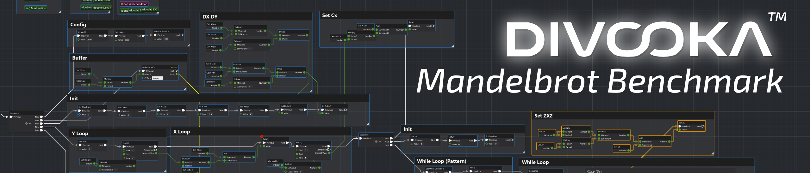

# Divooka Mandelbrot Benchmark

Benchmarks for Divooka, against the languages people would otherwise reach for: **Mandelbrot**, a tight loop of arithmetic, and **Ray Tracer**, a small but complete program that reads a scene from a file, recurses, and writes a picture.

## Experiment Set

> Conclusion: A JIT (just-in-time compiler) is essential to any modern high performance scripting language.

### Mandelbrot

**Setup**

* 2000 x 2000, MaxIter = 1000 (correct output: 689833081); every program also takes the size as `[width] [height] [maxIter]`
* Exercises integer math, floating point, loops, branches, function calls, and memory writes
* Every run's printed checksum is compared with the reference's, and a run that differs is not counted

**Results (20261024)**

Every language run again with the method below: the median of five rounds, three for the slow ones, with the fastest and slowest run beside it. **Provisional**: other work was running on the machine. The programs that take seconds were measured twice, and their rows are from the quieter session (the processor 4% to 35% busy before each round, 26% at the median); the slow ones, from Elixir down, ran once, with the processor 7% to 92% busy (38% at the median), which slows a long run most: Python's median is twice what it was in March on the same Python.

|Rank (by Time)|Platform|Size|Run Time (ms, median)|Range (ms)|Peak Memory|
|-|-|-|-:|-|-:|
|1|Go|2.4 MB|1,335.84|1,294.75 - 5,219.69|37.48 MB|
|2|C++|15 KB|1,368.68|1,347.09 - 1,490.50|19.08 MB|
|3|C# AoT|916 KB|1,406.34|1,382.91 - 1,619.13|22.30 MB|
|4|JavaScript (Node)|1 KB + 104 MB|1,441.62|1,425.10 - 1,529.44|53.57 MB|
|5|JavaScript (Web/Chrome)|3 KB|1,466.70 (render only)|1,375.70 - 1,525.80|N/A|
|6|Julia|1 KB + 1.1 GB|1,546.59|1,523.35 - 1,831.54|163.32 MB|
|7|C# (.NET 10)|12.3 MB|1,556.33|1,518.21 - 1,630.63|40.13 MB|
|8|Java (Temurin 17.0.11)|2 KB + 303 MB|2,225.39|1,703.51 - 2,905.58|56.14 MB|
|9|Pure 2 (Divooka Pure)|1 KB + 1.75 GB|2,526.64|2,432.84 - 2,683.12|202.84 MB|
|10|Haskell (GHC 9.10.3)|11.4 MB|2,831.05|2,818.44 - 2,921.94|43.38 MB|
|11|Divooka (AviatorBeta program)|77.2 MB|3,793.71|3,754.41 - 4,236.41|53.61 MB|
|12|Divooka (Stewer, compiled)|7 KB + 1.75 GB|6,410.04|6,120.30 - 6,912.88|343.46 MB|
|13|Elixir (1.14.4, OTP 25)|2 KB + 387 MB|12,973.86|10,847.94 - 19,745.77|56.94 MB|
|14|Ruby (4.0.9)|1 KB + 304 MB|96,404.04|82,093.14 - 111,871.05|47.19 MB|
|15|Python (3.13.5)|1 KB + 151 MB|96,981.26|84,764.84 - 97,928.50|61.74 MB|
|16|Perl (5.42.3)|1 KB + 1.1 GB|206,107.18|201,216.36 - 224,165.19|200.11 MB|
|17|Prolog (SWI 9.0.4)|2 KB + 47 MB|664,090.70 (11 min)|576,466.76 - 672,132.51|13.66 MB|
|18|GNU Octave (7.3.0)|1 KB + 2.2 GB|(Est.) 5,074,024 (85 min)|from 7,624 at 100 x 100 and 45,319 at 200 x 200|35.17 MB|
|19|Divooka (Stewer, interpreted)|7 KB + 1.75 GB|(Est.) 13,517,210 (3.8 hr)|from 49,078 at 100 x 100 and 149,285 at 200 x 200|205.57 MB|
|N/A|Divooka (GP; Stewer)|||Not runnable: see [Divooka (GP; Stewer)](#divooka-gp-stewer)||

Notes:

* Size is the program and what it needs to run: a built program alone, or a script plus its runtime's installed folder. Go and Haskell are built ahead of time, so their toolchains (255 MB and 3.4 GB) are needed only to build. Divooka's documents run in a Divooka Compute folder (1.75 GB, everything included), which also carries Divooka Pure; the AviatorBeta program is a document built into a self-contained program of its own, as Divooka Compute's Publish builds one.
* "Divooka (Stewer, compiled)" compiles the document on every run, which is most of its distance from the AviatorBeta program; "Divooka (Stewer, interpreted)" is the node-by-node interpreter the editor's Interpreted run uses. The Neo editor's estimate in the earlier results, 95.8 hours, was that interpreter's ancestor; the estimate here is 3.8 hours, on a busier machine.
* Pure 2 runs the C# version as a script, which Roslyn compiles when the run starts, inside Divooka Pure's process.
* Estimates: see Method. GNU Octave measured 41 minutes for the full size in March; its estimate here is twice that, as Python's median is twice March's.

### Ray Tracer

A small but complete command-line ray tracer: it reads a scene from a text file, traces it, and writes the picture as a binary PPM. Spheres and planes, plain and checkered materials, point lights casting hard shadows, Phong highlights, mirror reflections, and several samples per pixel. It exercises what Mandelbrot does not: reading and parsing a file, records and lists, recursion, a call per intersection, and writing a binary file.

* `raytracer <scene.txt> <output.ppm>`; it prints `Checksum: <the sum of every byte of the picture>`.
* The scene (`RayTracer/scene.txt`): 640 x 480, 2 x 2 samples per pixel, reflections 4 deep, a checkered floor, a mirror sphere and four coloured ones, two lights. Correct output: `Checksum: 167196110`, and a picture whose SHA-256 is `c481fbea89bb8e6b7d2a97202005b1e3a65f3dfc5daf1abfff4c301debcf9c14`.
* **Every language writes the same picture, to the byte.** The C# version (`RayTracer/Scripts/C#`) is the reference, and every other one makes the same floating-point operations in the same order: vectors are added, subtracted, multiplied and divided component by component; `dot(a, b) = (a.x*b.x + a.y*b.y) + a.z*b.z`; `length(v) = sqrt(dot(v, v))`; `normalize(v) = v * (1 / length(v))`; a power with a whole exponent is repeated multiplication; and nothing else is used but `+ - * /`, `sqrt`, `floor` and comparisons, which IEEE double precision rounds the same way everywhere. Nothing may fuse a multiply and an add into one instruction, which rounds once instead of twice: C++ is compiled with MSVC's default `/fp:precise`, Go for `GOAMD64=v1`, Java 17 is strict by definition. The harness checks every run's picture against the reference's.

**Scene format.** One directive per line, its words separated by spaces; `#` starts a comment, and blank lines are ignored. Colours are red, green and blue from 0 to 1. A material must be declared before a shape uses it.

|Directive|Meaning|Default|
|-|-|-|
|`size <width> <height>`|The picture's size in pixels.|`320 240`|
|`samples <n>`|n x n rays per pixel, spread evenly over it and averaged.|`1`|
|`depth <n>`|How many times a ray may bounce off mirrors.|`3`|
|`camera <eye x y z> <target x y z> <up x y z> <view>`|Where the eye is, what it looks at, which way is up, and half the height of the view at distance 1.|`0 0 0  0 0 1  0 1 0  0.5`|
|`background <r g b>`|The colour of a ray that meets nothing.|`0 0 0`|
|`ambient <r g b>`|The light every surface receives everywhere.|`0 0 0`|
|`light <x y z> <r g b>`|A point light: where it is and its colour.||
|`material <name> <r g b> <diffuse> <specular> <shininess> <reflect>`|A plain material: its colour, how much diffuse and specular light it returns, the highlight's exponent (a whole number), and how much of the mirrored ray it mixes in.||
|`checker <name> <r g b> <r g b> <scale> <diffuse> <specular> <shininess> <reflect>`|A checkerboard of two colours in squares `scale` wide, laid on x and z.||
|`sphere <x y z> <radius> <material>`|A sphere: its centre, radius and material.||
|`plane <x y z> <nx ny nz> <material>`|A plane through a point, facing along a normal.||

**What it computes.** For each pixel and sample, a ray from the eye through the view; the nearest shape it meets more than 0.0001 along it; that point's normal, turned to face the ray; the material's colour, or the checker's other colour where `floor(x / scale) + floor(z / scale)` is odd. The point is lit by the ambient light, and by each light no shape blocks: diffuse light (colour x light x diffuse x cos), and a highlight (light x specular x cos^shininess of the reflected light). A reflective material then mixes in what the mirrored ray sees, traced the same way while bounces remain. The samples are averaged, each channel clamped to 0..1, and written as `floor(sqrt(c) * 255 + 0.5)`.

**Results (20261024)**

Measured as Mandelbrot's were, and **provisional** for the same reason. The programs that take about a second come from the quieter of two sessions (the processor 4% to 34% busy before each round, 7% at the median); Elixir, Python, Ruby and Perl ran once, the processor 6% to 36% busy (32% at the median); Prolog ran at full size in a session of its own, the processor 1% to 12% busy. Every run wrote the reference's picture to the byte.

|Rank (by Time)|Platform|Size|Run Time (ms, median)|Range (ms)|Peak Memory|
|-|-|-|-:|-|-:|
|1|Go|2.6 MB|141.89|140.51 - 168.01|6.99 MB|
|2|C++|63 KB|151.74|149.05 - 190.49|5.11 MB|
|3|Java (Temurin 17.0.11)|10 KB + 303 MB|355.69|347.00 - 538.81|322.20 MB|
|4|JavaScript (Node)|7 KB + 104 MB|431.14|424.44 - 862.73|44.00 MB|
|5|C# AoT|1.1 MB|444.84|434.88 - 505.56|8.17 MB|
|6|Haskell (GHC 9.10.3)|16.5 MB|447.65|431.56 - 835.06|199.24 MB|
|7|C# (.NET 10)|12.2 MB|485.96|472.93 - 634.14|25.11 MB|
|8|Divooka (AviatorBeta program)|77.6 MB|648.64|622.13 - 746.16|43.02 MB|
|9|JavaScript (Web/Chrome)|10 KB|879.20 (render only)|241.30 - 889.10|N/A|
|10|Julia|8 KB + 1.1 GB|899.55|793.42 - 1,587.86|204.96 MB|
|11|Pure 2 (Divooka Pure)|10 KB + 1.75 GB|1,900.23|1,777.44 - 2,537.88|200.79 MB|
|12|Divooka (Stewer, compiled)|29 KB + 1.75 GB|4,293.93|4,111.23 - 7,034.08|364.79 MB|
|13|Elixir (1.14.4, OTP 25)|8 KB + 387 MB|8,534.71|8,243.15 - 11,361.51|84.22 MB|
|14|Python (3.13.5)|8 KB + 151 MB|28,154.45|27,946.62 - 30,782.72|12.68 MB|
|15|Ruby (4.0.9)|6 KB + 304 MB|28,546.87|27,152.62 - 30,082.89|25.62 MB|
|16|Prolog (SWI 9.0.4)|12 KB + 47 MB|83,120.65|79,749.23 - 86,469.49|14.61 MB|
|17|Perl (5.42.3)|7 KB + 1.1 GB|99,681.72|84,859.91 - 123,144.87|78.71 MB|
|18|GNU Octave (7.3.0)|8 KB + 2.2 GB|(Est.) 2,734,400 (46 min)|from 7,837 at 80 x 60 and 39,914 at 160 x 120|35.80 MB|
|19|Divooka (Stewer, interpreted)|29 KB + 1.75 GB|(Est.) 3,600,795 (60 min)|from 8,225 at 80 x 60 and 50,491 at 160 x 120|256.31 MB|
|N/A|Divooka (GP; Stewer)|||Not runnable: see [Divooka (GP; Stewer)](#divooka-gp-stewer)||

Notes:

* About a second of work is not much next to a runtime's start-up, so on this benchmark Java's and Julia's include a large share of starting, and Julia compiles the program on every run.
* The estimate's method was checked on Prolog, the one slow program also run at full size: it was estimated at 78.6 seconds from the two smaller scenes and measured at 83.1.
* Chrome's figure moved more than any other between runs, from 241 to 889 ms, with the page timing its own render after a warm-up.

### Earlier results

Taken from March to October 2026 with the previous version of `Benchmark/Benchmark.ps1`, which ran each program five times in a row; the table shows each program's fastest run, and is kept as it was, but for the empty rows it held for Haskell, Julia, Perl, Elixir, Pure 2 and Divooka (GP; Stewer), which the 20261024 tables fill. The 20261024 tables above re-measure every language with the method below, so compare within a table, not across them.

**Best Results**

|Rank (by Time)|Platform|Size|Run Time (Ms)|Peak Memory|
|-|-|-|-|-|
|1 (Tie)|JavaScript (Web/MS Edge)|3 KB|1,295.80 (No startup time)|≈9.54 MB|
|1 (Tie)|JavaScript (Web/Chrome)|3 KB|1,298.70 (No startup time)|≈9.54 MB|
|1 (Tie)|JavaScript (Web/Brave)|3 KB|1,302.80 (No startup time)|≈9.54 MB|
|2|C++|15 KB|1,308.00|18.62 MB|
|3|C# AoT|911 KB|1,355.35|17.98 MB|
|4|C# (.Net 10)|16.5 MB|1,357.47|26.88 MB|
|5|JavaScript (Node)|2 KB + 98.2 MB|1,406.20|49.47 MB|
|6|Go|2 KB + 224 MB|1,425.01|20.79 MB|
|7|Julia|2 KB + 1 GB|1,511.20|227.08 MB|
|8|JavaScript (Web/Firefox)|3 KB|1,513.00|N/A|
|9|Java (OpenJDK) (17.0.11)|2 KB + 2 KB + 301 MB|1,587.79|55.2 MB|
|10|Divooka (0.75.2; Compiled)|71.914 MB|3,639.24|47.46 MB|
|11|Divooka (0.75.2; Aviator Run)|8 KB + 2.16 GB (Distribution) + 776 MB (SDK)|6,710.84|145.61 MB|
|12|Divooka (0.75.2; Stewer)|8 KB + 2.16 GB|7,064.98|292.98 MB|
|13|ChatGPT (5.3 Instant)|N/A|26,320.00|N/A|
|14|Python (3.13.5)|2 KB + 139 MB|47,127.70|61.4 MB|
|15|Ruby (3.2.2)|1 KB + 907 MB|49,489.82|52.45 MB|
|16|Prolog (SWI) (With optimization)|2 KB + 42.8 MB|314,687.84|12.67 MB|
|17|Kimi (2.6 Instant)|N/A|340,330.00|N/A|
|18|GNU Octave (7.3.0)|2 KB + 2.07 GB|2,464,913.29 (41 min)|5.46Mb|
|19|Divooka (0.75.2; Neo Editor)|8 KB + 2.67 GB|(Est.) 344,880,000 (95.8 Hr)|851 MB|
|20 (Tie)|Grok (Fast)|N/A|Failed|N/A|
|20 (Tie)|Gemini (Fast)|N/A|Failed|N/A|

Notes:

* Size refer to default distribution, which can typically be further optimized (e.g. embedded python, Divooka™ Compute)
* GenAI results are provided as it's of general interest in this AI age.

Observations:

* Damn JavaScript is fast.
* Python is surprisingly slow.
* GNU Octave is surprisingly slow.
* JavaScript is surprisingly fast.
* I know Octave is probably optimized for matrix operations - but raw iteration speed is 💩.
* Ruby.. oh my Ruby...
* GNU Octave seems very naive interpretation (but ues very little memory)?
* Modern scripting languages are not usable without JIT.

**Programming Languages Only**

(Filtered to languages/runtimes only. AI models removed. Ties condensed.)

| Rank | Language / Runtime                      |                 Size |          Run Time (ms) | Peak Memory |
| ---- | --------------------------------------- | -------------------: | ---------------------: | ----------: |
| 1    | JavaScript (Web: Edge / Chrome / Brave) |                 3 KB |      1,295.80–1,302.80 |    ≈9.54 MB |
| 2    | C++                                     |                15 KB |               1,308.00 |    18.62 MB |
| 3    | C# AoT                                  |               911 KB |               1,355.35 |    17.98 MB |
| 4    | C# (.NET 10)                            |              16.5 MB |               1,357.47 |    26.88 MB |
| 5    | JavaScript (Node.js)                    |       2 KB + 98.2 MB |               1,406.20 |    49.47 MB |
| 6    | Go                                      |        2 KB + 224 MB |               1,425.01 |    20.79 MB |
| 7    | Julia                                   |                 1 GB |               1,511.20 |   227.08 MB |
| 8    | JavaScript (Web: Firefox)               |                 3 KB |               1,513.00 |         N/A |
| 9    | Java (OpenJDK 17.0.11)                  | 301 MB + small files |               1,587.79 |     55.2 MB |
| 10   | Divooka 0.75.2 (Compiled)               |            71.914 MB |               3,639.24 |    47.46 MB |
| 11   | Divooka 0.75.2 (Aviator Run)            | 8KB + 2.16GB + 776MB |               6,710.84 |   145.61 MB |
| 12   | Divooka 0.75.2 (Stewer)                 |       8 KB + 2.16 GB |               7,064.98 |   292.98 MB |
| 13   | Python 3.13.5                           |        2 KB + 139 MB |              47,127.70 |     61.4 MB |
| 14   | Ruby 3.2.2                              |        1 KB + 907 MB |              49,489.82 |    52.45 MB |
| 15   | Prolog (SWI, optimized)                 |       2 KB + 42.8 MB |             314,687.84 |    12.67 MB |
| 16   | GNU Octave 7.3.0                        |       2 KB + 2.07 GB | 2,464,913.29 (~41 min) |     5.46 MB |
| 17   | Divooka 0.75.2 (Neo Editor, est.)       |       8 KB + 2.67 GB | 344,880,000 (~95.8 hr) |      851 MB |

Notes:

* Fastest overall: JavaScript in browser.
* Fastest native binary: C++.
* Best managed runtime: C#.
* Divooka compiled lands mid-pack, beating Python, Ruby, Prolog, Octave by large margins.
* Divooka runtime/editor modes show tooling overhead rather than core language speed.

## Running the benchmarks

```
pwsh Benchmark/Build.ps1                                   # C++, C#, C# AoT, Go, Java and Haskell, both benchmarks, into Artifacts/Build;
                                                           # with BENCH_AVIATOR set to a Divooka Compute folder's AviatorBeta.exe, each Divooka document as a program too
pwsh Benchmark/Benchmark.ps1 -Benchmark Mandelbrot         # every program, five rounds, slow ones three
pwsh Benchmark/Benchmark.ps1 -Benchmark RayTracer -Only 'C#','Divooka*'
```

`Benchmark.ps1` finds each language on PATH, or where an environment variable says: `BENCH_JAVA` (else `JAVA_HOME`'s), `BENCH_NODE`, `BENCH_JULIA`, `BENCH_PYTHON`, `BENCH_RUBY`, `BENCH_PERL`, `BENCH_ERL` with `BENCH_ELIXIR` (the folder holding Elixir's `lib`), `BENCH_SWIPL`, `BENCH_OCTAVE` (`octave-cli`), `BENCH_PURE` (`pure.exe`: Divooka Pure's, or Pure 2's own), `BENCH_STEW` (`stew.exe` in a Divooka Compute folder) and `BENCH_CHROME`. A program whose language is not found is skipped, and the run says so. Every run, and the summary table, is written under `Results/` (ignored by git).

The Divooka documents (`Scripts/Divooka/mandelbrot.dvk`, `RayTracer/Scripts/Divooka/Ray Tracer.dvk`) are written by the Divooka examples Writer, `DivookaExamplesWriter benchmarks <this folder>`, from recipes in the Parcel NExT repository (`MandelbrotRecipe`, `RayTracerBenchmarkRecipe`). Remake them after a Divooka format change rather than editing them. Run them with the `stew` of a Divooka Compute distribution:

```
stew Scripts/Divooka/mandelbrot.dvk 2000 2000 1000                                     # compiled, the default
stew --mode interpreted Scripts/Divooka/mandelbrot.dvk 200 200 1000                    # the interpreter
stew "RayTracer/Scripts/Divooka/Ray Tracer.dvk" RayTracer/scene.txt picture.ppm
```

## Method

From the 20261024 record on, every figure here is measured by `Benchmark/Benchmark.ps1`, which works as follows. Earlier records were taken with the previous version of the script, which ran each program five times in a row and summarized the runs by their average, fastest and slowest; they are kept below as they were.

* **Alternated.** Every program runs once per round, and the order turns by one place each round, so whatever else the machine was doing lands on every program alike rather than on whichever happened to be running.
* **One run, one process,** started with its standard input closed - a program that waits for input would otherwise wait for ever (GNU Octave does, given a terminal).
* **Median and range.** The time is the wall clock from starting the process to its exit, so a runtime's start-up is in it, as it is for anyone running the program. Each figure is the median of the rounds, with the fastest and slowest beside it; never an average, and never a best run. Five rounds for programs that take seconds, three for the slow ones.
* **Peak memory** is the peak working set Windows recorded for the process. Elixir is started on the Erlang runtime directly, as `elixir.bat` would start it, so the process measured is the one doing the work.
* **Right answers only.** The reference (C# AoT) runs first on every size used; a run counts only if it printed the reference's checksum - and, for the ray tracer, wrote a picture whose SHA-256 is the reference's. A wrong answer is reported and kept out of the figures.
* **Estimates.** A program too slow to run at full size - GNU Octave and Divooka interpreted - runs at two smaller sizes instead (Mandelbrot 100 x 100 and 200 x 200 at 1000 iterations; the ray tracer's scene at 80 x 60 and 160 x 120 with one sample), and the full size's time is read off the line through the two, by the work each size does: the iterations a Mandelbrot run makes, which is its checksum, or the primary rays the ray tracer traces. Estimates are labelled.
* **The browser** times itself: Chrome runs the page headless, and the page times its own render after a warm-up render, so its figure has no start-up in it and is not comparable with the others'. Its memory is not measured.
* **The machine's load** is sampled before every round and reported with the results. A busy machine moves every figure; when it was busy, the record says so and the figures are provisional.

## Toolchains (20261024)

What the 20261024 record ran on. The ones marked *installed for this record* were added to the machine then, each with its vendor's own silent installer or archive, for the current user, and put on the user's PATH; the rest were already there.

|Language|Version|Where|
|-|-|-|
|C++|MSVC 14.51 (Visual Studio Community 2026 18.10.1), `/O2`, `/fp:precise`|Visual Studio's own|
|C#, C# AoT|.NET SDK 10.0.401 (runtime 10.0); C# self-contained single-file trimmed, C# AoT NativeAOT|`C:\Program Files\dotnet`|
|Go|1.26.1, `GOAMD64=v1`|`C:\Program Files\Go`|
|Java|Eclipse Temurin 17.0.11 (`JAVA_HOME`)|`C:\Program Files\Eclipse Adoptium\jdk-17.0.11.9-hotspot`|
|Haskell|GHC 9.10.3, `-O2`, by GHCup 0.2.7.0 - *installed for this record*|`C:\ghcup`|
|JavaScript (Node)|Node.js 24.11.1|`C:\Program Files\nodejs`|
|JavaScript (Web)|Chrome 155, headless|`C:\Program Files\Google\Chrome`|
|Julia|1.13.2 - *installed for this record*|`%LOCALAPPDATA%\Programs\Julia-1.13.2`|
|Python|CPython 3.13.5|`C:\Program Files\Python313`|
|Ruby|4.0.9 (RubyInstaller, built without YJIT) - *installed for this record*|`C:\Ruby40-x64`|
|Perl|Strawberry Perl 5.42.3.1, portable - *installed for this record*|`C:\Strawberry`|
|Elixir|1.14.4 on Erlang/OTP 25|`C:\Program Files (x86)\Elixir`, `C:\Program Files\Erlang OTP`|
|Prolog|SWI-Prolog 9.0.4|`C:\Program Files\swipl`|
|GNU Octave|7.3.0, `octave-cli`|`C:\Program Files\GNU Octave\Octave-7.3.0`|
|Pure 2|Divooka Pure 0.1.0 (Pure 2.3.0), from the Divooka Compute build below|that build's `pure.exe`|
|Divooka|Divooka Compute, built from Parcel NExT's round-24 branch (`r24-performance`), with `stew` 0.8.0 and AviatorBeta 0.2|that build's `stew.exe` and `AviatorBeta.exe`|

## Divooka (GP; Stewer)

This row stays empty, and why is worth saying. "GP" is general-purpose GPU compute: a document's graph emitted as a compute shader and run on the graphics card. Divooka's code generator has the mode (`GPCompute`), but it is not implemented - `DivookaGLSLCodeGen.GenerateGraphGPComputePreviewScript` throws `NotImplementedException` - and `stew` has no way to ask for it, so there is no program to run. The fragment-shader generator beside it is implemented, but it draws the editor's shader previews; it does not make a program that runs on the command line and prints a checksum.

## Records

### 20260328

```
CPU       : 13th Gen Intel(R) Core(TM) i7-13700KF
Cores     : 16
Threads   : 24
RAM_GB    : 127.84
GPU       : NVIDIA GeForce RTX 4090
OS        : Microsoft Windows 11 Pro
OSVersion : 10.0.22631
```

**Run 1**

```
Name       Run ExitCode   TimeMs PeakMemoryMB
----       --- --------   ------ ------------
C++          1        0  2466.36         0.00
C++          2        0  2016.02         0.00
C++          3        0  2005.51         0.00
C++          4        0  2008.23         0.00
C++          5        0  2010.93         0.00
C# Trimmed   1        0  2113.89         0.00
C# Trimmed   2        0  2007.61         0.00
C# Trimmed   3        0  2008.79         0.00
C# Trimmed   4        0  2002.98         0.00
C# Trimmed   5        0  2005.13         0.00
C# AoT       1        0  2047.63         0.00
C# AoT       2        0  2015.38         0.00
C# AoT       3        0  2013.55         0.00
C# AoT       4        0  2005.27         0.00
C# AoT       5        0  2015.76         0.00
Python       1        0 53020.98         0.00
Python       2        0 51016.43         0.00
Python       3        0 48010.12         0.00
Python       4        0 48008.35         0.00
Python       5        0 53017.28         0.00

Summary:

Name       Runs AvgTimeMs MinTimeMs MaxTimeMs AvgPeakMemoryMB MaxPeakMemoryMB
----       ---- --------- --------- --------- --------------- ---------------
C# AoT        5   2019.52   2005.27   2047.63            0.00            0.00
C# Trimmed    5   2027.68   2002.98   2113.89            0.00            0.00
C++           5   2101.41   2005.51   2466.36            0.00            0.00
Python        5  50614.63  48008.35  53020.98            0.00            0.00
```

**Run 2**

```
Name       Run ExitCode   TimeMs PeakMemoryMB PeakMemoryKB
----       --- --------   ------ ------------ ------------
C++          1        0  1329.55        18.88     19336.00
C++          2        0  1323.36        18.57     19012.00
C++          3        0  1314.83        18.56     19004.00
C++          4        0  1332.19        18.56     19004.00
C++          5        0  1308.00        18.55     19000.00
C# Trimmed   1        0  1365.41        29.60     30308.00
C# Trimmed   2        0  1360.31        29.11     29804.00
C# Trimmed   3        0  1357.47        25.53     26140.00
C# Trimmed   4        0  1382.25        24.84     25440.00
C# Trimmed   5        0  1367.06        25.32     25932.00
C# AoT       1        0  1386.98        17.80     18232.00
C# AoT       2        0  1366.62        17.93     18356.00
C# AoT       3        0  1355.35        18.74     19192.00
C# AoT       4        0  1374.50        17.34     17756.00
C# AoT       5        0  1355.38        17.96     18388.00
Python       1        0 57932.10        61.42     62892.00
Python       2        0 53340.35        61.42     62896.00
Python       3        0 47127.70        61.39     62868.00
Python       4        0 47748.71        61.40     62876.00
Python       5        0 47256.38        61.39     62868.00


Summary:

Name       Runs AvgTimeMs MinTimeMs MaxTimeMs AvgPeakMemoryMB MaxPeakMemoryMB AvgPeakMemoryKB MaxPeakMemoryKB
----       ---- --------- --------- --------- --------------- --------------- --------------- ---------------
C++           5   1321.59   1308.00   1332.19           18.62           18.88        19071.20        19336.00
C# Trimmed    5   1366.50   1357.47   1382.25           26.88           29.60        27524.80        30308.00
C# AoT        5   1367.77   1355.35   1386.98           17.95           18.74        18384.80        19192.00
Python        5  50681.05  47127.70  57932.10           61.40           61.42        62880.00        62896.00
```

## 20260329

```
Name       Run ExitCode  TimeMs PeakMemoryMB PeakMemoryKB
----       --- --------  ------ ------------ ------------
Java         1        0 2172.38        54.81     56124.00
Java         2        0 1587.79        55.12     56444.00
Java         3        0 2170.23        54.94     56260.00
Java         4        0 2180.13        55.20     56520.00
Java         5        0 2161.38        54.95     56268.00
JS (Node)    1        0 1414.63        48.76     49932.00
JS (Node)    2        0 1408.87        50.67     51884.00
JS (Node)    3        0 1416.41        48.07     49224.00
JS (Node)    4        0 1421.06        49.81     51008.00
JS (Node)    5        0 1406.20        50.05     51248.00


Summary:

Name       Runs AvgTimeMs MinTimeMs MaxTimeMs AvgPeakMemoryMB MaxPeakMemoryMB AvgPeakMemoryKB MaxPeakMemoryKB
----       ---- --------- --------- --------- --------------- --------------- --------------- ---------------
JS (Node)     5   1413.43   1406.20   1421.06           49.47           50.67        50659.20        51884.00
Java          5   2054.38   1587.79   2180.13           55.00           55.20        56323.20        56520.00
```

```
Name         Run ExitCode    TimeMs PeakMemoryMB PeakMemoryKB
----         --- --------    ------ ------------ ------------
Go             1        0   1524.35        20.63     21124.00
Go             2        0   1430.81        21.00     21500.00
Go             3        0   1570.79        21.45     21960.00
Go             4        0   1437.50        20.39     20884.00
Go             5        0   1425.01        20.47     20960.00
Ruby           1        0  49693.17        52.45     53712.00
Ruby           2        0  49644.62        52.49     53748.00
Ruby           3        0  49489.82        52.48     53740.00
Ruby           4        0  49720.23        52.38     53636.00
Ruby           5        0  49634.29        52.44     53696.00
Prolog (SWI)   1        0 314687.84        12.66     12960.00
Prolog (SWI)   2        0 317327.18        12.68     12984.00
Prolog (SWI)   3        0 336952.45        12.66     12964.00
Prolog (SWI)   4        0 314983.90        12.67     12972.00
Prolog (SWI)   5        0 338078.59        12.68     12984.00


Summary:

Name         Runs AvgTimeMs MinTimeMs MaxTimeMs AvgPeakMemoryMB MaxPeakMemoryMB AvgPeakMemoryKB MaxPeakMemoryKB
----         ---- --------- --------- --------- --------------- --------------- --------------- ---------------
Go              5   1477.69   1425.01   1570.79           20.79           21.45        21285.60        21960.00
Ruby            5  49636.43  49489.82  49720.23           52.45           52.49        53706.40        53748.00
Prolog (SWI)    5 324405.99 314687.84 338078.59           12.67           12.68        12972.80        12984.00
```

## 20260330

```
Name       Run ExitCode     TimeMs PeakMemoryMB PeakMemoryKB
----       --- --------     ------ ------------ ------------
GNU Octave   1        0 2485694.66         5.50      5628.00
GNU Octave   2        0 2464913.29         5.45      5580.00
GNU Octave   3        0 2483131.48         5.45      5580.00
GNU Octave   4        0 2468400.16         5.44      5572.00
GNU Octave   5        0 2474652.51         5.45      5584.00


Summary:

Name       Runs  AvgTimeMs  MinTimeMs  MaxTimeMs AvgPeakMemoryMB MaxPeakMemoryMB AvgPeakMemoryKB MaxPeakMemoryKB
----       ----  ---------  ---------  --------- --------------- --------------- --------------- ---------------
GNU Octave    5 2475358.42 2464913.29 2485694.66            5.46            5.50         5588.80         5628.00
```

## 20260424

Divooka (Editor): 1252.223s for 2504172 iterations (Index: 840000); DRAM: 851MB. 
Estimated: (689833081 Iterations) 500.05µ/iter. 95.8Hr.

## 20260426

ChatGPT:

1. Run 1: 26.32s
2. Run 2: >3 mins (never replied, stuck on "working")

ChatGPT doesn't produce reliable outputs.

Gemini:

1. Run 1: "Something went wrong"
2. Run 2: 7.94s (Failed; Wrong output)

Grok:

1. Run 1: "No response. Grok was unable to finish replying."
2. Run 2: "No response. Grok was unable to finish replying."

Kimi:

1. Run 1: 340.33s (5 min 40.33s) (Through automatic tool use by executing Python Code; Tried twice automatically; First time encountered syntax error in its own generated code. Tried multiple times with variations.)

Notice through prompt engineering it's possible to fine tune AI's behavior (e.g. as it to use or not use tools), but we are relying on default behaviors for benchmark.

Because GenAI results are lengthy, not replicable, and contains lost of garbage, we chose not to include the transcripts and just record the final result. Some interesting results are available in `Scripts/GenAI/Prompt.md` - especially *Kimi's approach is interesting*. 

```
Name  Run ExitCode  TimeMs PeakMemoryMB PeakMemoryKB
----  --- --------  ------ ------------ ------------
Julia   1        0 1537.54       227.17    232620.00
Julia   2        0 1514.19       227.45    232908.00
Julia   3        0 1523.34       226.63    232072.00
Julia   4        0 1523.83       226.77    232208.00
Julia   5        0 1511.20       227.38    232840.00


Summary:

Name  Runs AvgTimeMs MinTimeMs MaxTimeMs AvgPeakMemoryMB MaxPeakMemoryMB AvgPeakMemoryKB MaxPeakMemoryKB
----  ---- --------- --------- --------- --------------- --------------- --------------- ---------------
Julia    5   1522.02   1511.20   1537.54          227.08          227.45       232529.60       232908.00
```

```
Name               Run ExitCode   TimeMs PeakMemoryMB PeakMemoryKB
----               --- --------   ------ ------------ ------------
Divooka (Aviator)    1        0 19066.15       153.90    157596.00
Divooka (Aviator)    2        0  6781.78       141.44    144836.00
Divooka (Aviator)    3        0  6797.91       145.53    149020.00
Divooka (Aviator)    4        0  6735.67       145.66    149156.00
Divooka (Aviator)    5        0  6710.84       141.52    144912.00
Divooka (Compiled)   1        0  3683.26        46.94     48068.00
Divooka (Compiled)   2        0  3649.01        48.62     49788.00
Divooka (Compiled)   3        0  3665.22        45.46     46548.00
Divooka (Compiled)   4        0  3639.24        47.11     48240.00
Divooka (Compiled)   5        0  3663.75        49.19     50372.00


Summary:

Name               Runs AvgTimeMs MinTimeMs MaxTimeMs AvgPeakMemoryMB MaxPeakMemoryMB AvgPeakMemoryKB MaxPeakMemoryKB
----               ---- --------- --------- --------- --------------- --------------- --------------- ---------------
Divooka (Compiled)    5   3660.10   3639.24   3683.26           47.46           49.19        48603.20        50372.00
Divooka (Aviator)     5   9218.47   6710.84  19066.15          145.61          153.90       149104.00       157596.00
```

## 20260428

```

Name             Run ExitCode   TimeMs PeakMemoryMB PeakMemoryKB
----             --- --------   ------ ------------ ------------
Divooka (Stewer)   1        0 20472.50       300.78    307996.00
Divooka (Stewer)   2        0  7071.69       288.17    295084.00
Divooka (Stewer)   3        0  7115.90       290.74    297716.00
Divooka (Stewer)   4        0  7164.90       295.25    302336.00
Divooka (Stewer)   5        0  7064.98       289.95    296904.00

Summary:

Name             Runs AvgTimeMs MinTimeMs MaxTimeMs AvgPeakMemoryMB MaxPeakMemoryMB AvgPeakMemoryKB MaxPeakMemoryKB
----             ---- --------- --------- --------- --------------- --------------- --------------- ---------------
Divooka (Stewer)    5   9777.99   7064.98  20472.50          292.98          300.78       300007.20       307996.00
```

## 20261019 (Divooka Matrix Operator, preview)

Divooka Matrix Operator runs the GNU Octave script (`Scripts/GNUOctave/mandelbrot.m`) unchanged. It is not public yet, so this record was taken on a different machine from the runs above; compare ratios, not absolute times:

```
Machine   : Linux x64 cloud VM, 2 vCPUs (shared)

Name                       Runs  TimeMs (each)              Checksum
----                       ----  -------------              --------
C# AoT (Scripts/C#AoT)        2  2462.70  2450.36           689833081
Divooka Matrix Operator       3  15327.90 14690.10 14594.94 689833081
```

On the same machine, a 200 x 200 version of the script takes 27.7 s in GNU Octave 11.1 and 0.14 s in Divooka Matrix Operator, so the full 2000 x 2000 run would take GNU Octave roughly 45-50 minutes there, in line with the 41 minutes recorded above. Divooka Matrix Operator is about 6 times slower than C# AoT on this loop-heavy script, and about 200 times faster than GNU Octave.

## 20261019 (Divooka Matrix Operator JIT build, preview)

Same machine and script as the previous record (Linux x64 cloud VM, 2 vCPUs, shared; `Scripts/GNUOctave/mandelbrot.m` run unchanged). Divooka Matrix Operator now also ships a JIT build next to its ahead-of-time compiled default; both are self-contained (no runtime to install).

```
Name                              Runs  TimeMs (each)            Checksum
----                              ----  -------------            --------
C# AoT (Scripts/C#AoT)               2  2361.25  2473.54         689833081
Divooka Matrix Operator (JIT)        3  2602.32  2656.41  2604.21 689833081
Divooka Matrix Operator (default)    -  about 13,600-15,300 (previous record)
```

The JIT build runs this loop-heavy script within about 10% of C# AoT. It starts slower (about 60 ms instead of 10 ms) and is larger to download, so the ahead-of-time compiled build stays the default for general use.

## 20261024

Every language of both benchmarks, measured by `Benchmark/Benchmark.ps1` as described under Method, on the machine of the earlier records, with the toolchains listed under Toolchains. Other work was running on the machine through all of it, so every figure is provisional; the processor's load before each round is in each run's first line. Five sessions: the whole of each benchmark, then the programs that take seconds again while the machine was quieter, and the Prolog ray tracer at full size instead of estimated.

```
CPU       : 13th Gen Intel(R) Core(TM) i7-13700KF
Cores     : 16
Threads   : 24
RAM_GB    : 127.84
OS        : Microsoft Windows 11 Pro
OSVersion : 10.0.22631
```

**Mandelbrot, every program**

Benchmark: Mandelbrot (2000x2000x1000); rounds: 5 (slow programs and estimates: 3); processor load before each round: median 37.5% (range 6.8% - 91.5%)

|Program|Median (ms)|Range (ms)|Peak memory (MB)|Runs|Wrong|Note|
|-|-:|-|-:|-:|-:|-|
|C++|1,367.08|1,351.41 - 2,560.07|19.09|5|0||
|JavaScript (Web/Chrome)|1,497.70|1,469.90 - 1,676.80|N/A|5|0|in page, render only|
|JavaScript (Node)|1,549.75|1,408.47 - 2,313.01|53.71|5|0||
|C# AoT|1,553.85|1,375.69 - 2,459.25|22.30|5|0||
|Go|1,617.14|1,300.07 - 2,997.06|37.45|5|0||
|Julia|1,676.67|1,515.85 - 4,850.71|163.34|5|0||
|C#|1,677.99|1,607.90 - 2,382.66|40.16|5|0||
|Pure 2|2,539.91|2,399.60 - 4,305.90|203.09|5|0||
|Java|2,571.02|1,661.97 - 3,035.47|55.91|5|0||
|Haskell|2,902.69|2,753.17 - 3,240.83|43.38|5|0||
|Divooka (AviatorBeta program)|3,956.45|3,696.86 - 4,578.71|53.55|5|0||
|Divooka (stew, compiled)|7,337.78|6,116.94 - 8,508.83|344.27|5|0||
|Elixir|12,973.86|10,847.94 - 19,745.77|56.94|3|0||
|Ruby|96,404.04|82,093.14 - 111,871.05|47.19|3|0||
|Python|96,981.26|84,764.84 - 97,928.50|61.74|3|0||
|Perl|206,107.18|201,216.36 - 224,165.19|200.11|3|0||
|Prolog (SWI)|664,090.70|576,466.76 - 672,132.51|13.66|3|0||
|GNU Octave|5,074,024.00|estimate, from medians 7,624 ms at 100x100x1000 and 45,319 ms at 200x200x1000|35.17|6|0|estimate; memory at 200x200x1000|
|Divooka (stew, interpreted)|13,517,210.00|estimate, from medians 49,078 ms at 100x100x1000 and 149,285 ms at 200x200x1000|205.57|6|0|estimate; memory at 200x200x1000|

**Mandelbrot, the programs that take seconds, again**

Benchmark: Mandelbrot (2000x2000x1000); rounds: 5 (slow programs and estimates: 3); processor load before each round: median 25.6% (range 3.9% - 35.4%)

|Program|Median (ms)|Range (ms)|Peak memory (MB)|Runs|Wrong|Note|
|-|-:|-|-:|-:|-:|-|
|Go|1,335.84|1,294.75 - 5,219.69|37.48|5|0||
|C++|1,368.68|1,347.09 - 1,490.50|19.08|5|0||
|C# AoT|1,406.34|1,382.91 - 1,619.13|22.30|5|0||
|JavaScript (Node)|1,441.62|1,425.10 - 1,529.44|53.57|5|0||
|JavaScript (Web/Chrome)|1,466.70|1,375.70 - 1,525.80|N/A|5|0|in page, render only|
|Julia|1,546.59|1,523.35 - 1,831.54|163.32|5|0||
|C#|1,556.33|1,518.21 - 1,630.63|40.13|5|0||
|Java|2,225.39|1,703.51 - 2,905.58|56.14|5|0||
|Pure 2|2,526.64|2,432.84 - 2,683.12|202.84|5|0||
|Haskell|2,831.05|2,818.44 - 2,921.94|43.38|5|0||
|Divooka (AviatorBeta program)|3,793.71|3,754.41 - 4,236.41|53.61|5|0||
|Divooka (stew, compiled)|6,410.04|6,120.30 - 6,912.88|343.46|5|0||

**Ray Tracer, every program**

Benchmark: RayTracer (scene.txt); rounds: 5 (slow programs and estimates: 3); processor load before each round: median 32.3% (range 6.2% - 35.7%)

|Program|Median (ms)|Range (ms)|Peak memory (MB)|Runs|Wrong|Note|
|-|-:|-|-:|-:|-:|-|
|C++|157.52|150.37 - 392.45|5.11|5|0||
|Go|185.57|143.94 - 1,015.78|6.88|5|0||
|Java|443.59|355.89 - 1,456.86|321.67|5|0||
|C# AoT|461.96|440.95 - 478.34|8.16|5|0||
|Haskell|489.03|422.71 - 1,294.00|199.25|5|0||
|C#|496.36|470.33 - 671.42|25.07|5|0||
|Divooka (AviatorBeta program)|678.51|636.69 - 1,074.00|43.06|5|0||
|JavaScript (Node)|699.04|429.58 - 1,795.24|44.04|5|0||
|JavaScript (Web/Chrome)|829.50|237.30 - 1,409.60|N/A|5|0|in page, render only|
|Julia|1,725.63|801.62 - 5,922.31|204.96|5|0||
|Pure 2|2,502.49|1,789.59 - 4,530.88|201.54|5|0||
|Divooka (stew, compiled)|4,460.27|3,853.87 - 4,928.16|375.53|5|0||
|Elixir|8,534.71|8,243.15 - 11,361.51|84.22|3|0||
|Python|28,154.45|27,946.62 - 30,782.72|12.68|3|0||
|Ruby|28,546.87|27,152.62 - 30,082.89|25.62|3|0||
|Prolog (SWI)|78,606.00|estimate, from medians 289 ms at 80x60 and 1,211 ms at 160x120|14.67|6|0|estimate; memory at 160x120|
|Perl|99,681.72|84,859.91 - 123,144.87|78.71|3|0||
|GNU Octave|2,734,400.00|estimate, from medians 7,837 ms at 80x60 and 39,914 ms at 160x120|35.80|6|0|estimate; memory at 160x120|
|Divooka (stew, interpreted)|3,600,795.00|estimate, from medians 8,225 ms at 80x60 and 50,491 ms at 160x120|256.31|6|0|estimate; memory at 160x120|

**Ray Tracer, Prolog at full size**

Benchmark: RayTracer (scene.txt); rounds: 5 (slow programs and estimates: 3); processor load before each round: median 3.4% (range 1.4% - 12.3%)

|Program|Median (ms)|Range (ms)|Peak memory (MB)|Runs|Wrong|Note|
|-|-:|-|-:|-:|-:|-|
|Prolog (SWI)|83,120.65|79,749.23 - 86,469.49|14.61|3|0||

**Ray Tracer, the programs that take seconds, again**

Benchmark: RayTracer (scene.txt); rounds: 5 (slow programs and estimates: 3); processor load before each round: median 6.7% (range 3.6% - 34.2%)

|Program|Median (ms)|Range (ms)|Peak memory (MB)|Runs|Wrong|Note|
|-|-:|-|-:|-:|-:|-|
|Go|141.89|140.51 - 168.01|6.99|5|0||
|C++|151.74|149.05 - 190.49|5.11|5|0||
|Java|355.69|347.00 - 538.81|322.20|5|0||
|JavaScript (Node)|431.14|424.44 - 862.73|44.00|5|0||
|C# AoT|444.84|434.88 - 505.56|8.17|5|0||
|Haskell|447.65|431.56 - 835.06|199.24|5|0||
|C#|485.96|472.93 - 634.14|25.11|5|0||
|Divooka (AviatorBeta program)|648.64|622.13 - 746.16|43.02|5|0||
|JavaScript (Web/Chrome)|879.20|241.30 - 889.10|N/A|5|0|in page, render only|
|Julia|899.55|793.42 - 1,587.86|204.96|5|0||
|Pure 2|1,900.23|1,777.44 - 2,537.88|200.79|5|0||
|Divooka (stew, compiled)|4,293.93|4,111.23 - 7,034.08|364.79|5|0||

The reference's answers: Mandelbrot 689833081 at 2000 x 2000 (1703126 at 100 x 100 and 6823016 at 200 x 200, the work the estimates are drawn through); the ray tracer `Checksum: 167196110` and SHA-256 `c481fbea89bb8e6b7d2a97202005b1e3a65f3dfc5daf1abfff4c301debcf9c14` for scene.txt, 2617306 and `12aa506a...` at 80 x 60, 10420415 and `18bccd53...` at 160 x 120.

## Limitations

Mandelbrot only tests simple loops and large integers; the ray tracer adds a file read, records, recursion and a binary write, but it is still one program:

* The browser times its own render after a warm-up, and no other program has a warm-up, so JavaScript (web) has an advantage, and its figures are not comparable with the others'.
* Every other time includes its runtime's start-up, as it does for anyone running the program: Julia and Java pay theirs on every run, and on the ray tracer, which takes about a second in the fastest languages, that start-up is a large share of what is measured.
* This tests raw run time speed, but different programming systems have different uses - e.g. people rarely use Python as is.
* Certain languages are more suited for certain things. GNU Octave is supposedly very good at matrix.
* The estimates assume the time a program takes grows in a straight line with the work it does; for a Mandelbrot run that work is its iterations, and for the ray tracer its primary rays, which spend about the same on average at any resolution of the same view.
